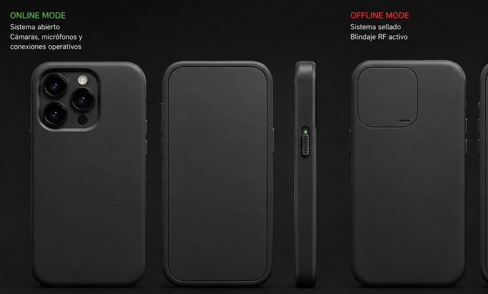
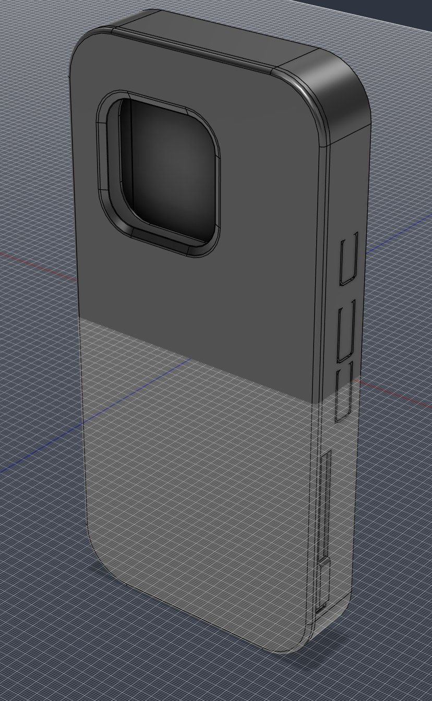
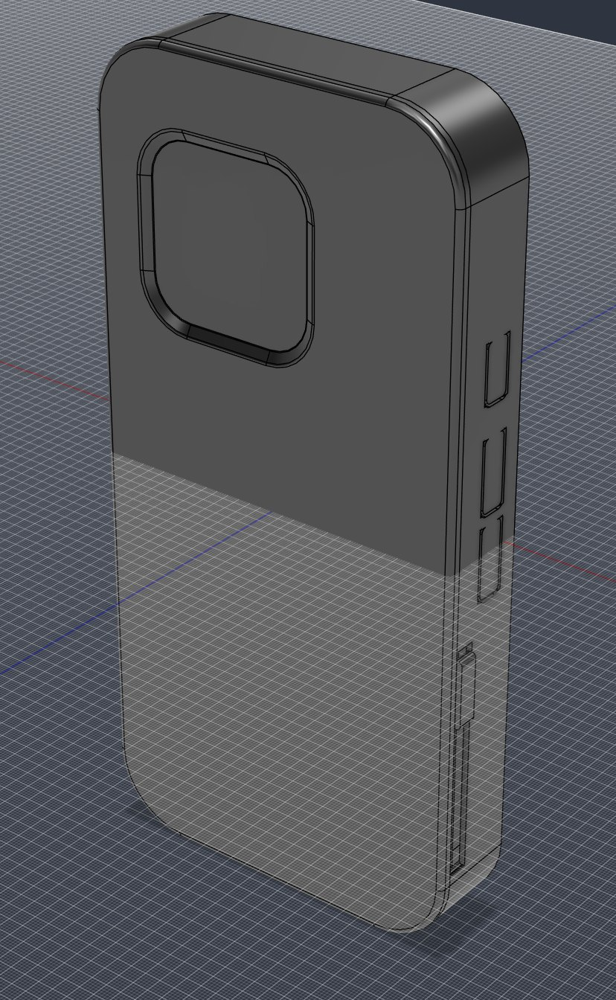

# AEGIS — privacidad física para tu teléfono

**Una funda para iPhone 15 Pro que, con un único deslizador lateral, tapa las cámaras, cierra micrófonos y altavoces y busca atenuar las señales inalámbricas. Sin batería, sin electrónica, sin app.**


<sub>Imagen conceptual generada con IA para comunicar la idea. No es el producto final.</sub>

📄 **Presentación completa:** [presentacion/AEGIS_Presentacion_Aportantes.pdf](presentacion/AEGIS_Presentacion_Aportantes.pdf)

---

## Campaña de crowdfunding: 6.000 €

Con **6.000 €** se financia la fase de prototipo funcional: rediseño del mecanismo, prototipos impresos, MVP demostrable y un primer ensayo de atenuación de radio.

**600 personas × 10 € = objetivo cumplido.** Si aportas 10 € y lo compartes con dos personas a las que les importe la privacidad, entre muy pocos lo conseguimos.

📬 **¿Quieres aportar o colaborar? Contacta conmigo** abriendo un [issue de contacto](../../issues/new?template=contacto.md). Te respondo con los detalles.

👉 **[Cómo aportar](DONAR.md)** (criptomonedas, MetaMask) · **[En qué se gasta](docs/presupuesto.md)**

## Hardware abierto

**Todo el diseño está publicado** con licencia **CERN-OHL-S-2.0**: CAD (STEP), planos, parámetros, memorias técnicas e informes de validación. Cualquiera puede estudiarlo, mejorarlo y fabricarlo, siempre que publique sus mejoras con la misma licencia. La privacidad real debe poder auditarse: si el mecanismo es abierto, cualquiera puede comprobar qué tapa y qué no.

---

## Cómo funciona

| ONLINE | OFFLINE |
|---|---|
|  |  |
| Cámaras, micrófonos, altavoces, botones y USB-C libres. Aspecto de funda normal. | Cubrecámaras trasero y frontal cerrados, entradas de micrófono y salidas de altavoz cerradas, envolvente conductora para atenuar radio (*objetivo pendiente de validar por ensayo*). |

<sub>Renders exteriores del CAD conceptual V3 del autor.</sub>

## Estado real del proyecto

Prefiero que aportes sabiendo exactamente qué hay y qué falta. Detalle en **[docs/estado-del-proyecto.md](docs/estado-del-proyecto.md)**.

- ✅ Producto definido, CAD conceptual propio en Fusion 360 y estudio técnico inicial de un estudio de ingeniería de fabricación aditiva (pagado por mí, con acuerdo de confidencialidad firmado).
- ⚠️ Conclusión del estudio: **el concepto merece desarrollo, pero el CAD actual es conceptual** y la arquitectura mecánica debe rediseñarse desde cero. El bloqueo de radio es una hipótesis que hay que demostrar con ensayos.
- 🔜 Próximo paso: Hito 1 (núcleo mecánico) y Hito 2 (MVP), financiados con este objetivo.

## Compromisos

- **Todo el dinero se invierte íntegramente en el desarrollo de AEGIS.** Publicaré aquí gastos y resultados de cada hito, también los negativos.
- **Leeré los comentarios y mensajes en GitHub** ([issues](../../issues) y discusiones del repositorio). Si quieres contactar conmigo, ese es el canal.
- **No puedo prometer un tiempo de respuesta concreto**: es un proyecto personal y respondo cuando puedo. Lo que sí es seguro es que el dinero irá al proyecto.
- Las aportaciones son **voluntarias y sin contraprestación**: no es una inversión con retorno, ni una preventa, ni da derechos sobre el proyecto.

## Después del iPhone 15 Pro

Está claro que esta fase es solo para **un modelo de teléfono**. Si funciona, y se vende o lo usa gente que lo quiere y lo apoya, **se trasladará a todos los modelos nuevos que sea posible**.

## Qué hay en este repositorio

```
README.md                     ← estás aquí
DONAR.md                      ← cómo aportar (cripto)
presentacion/
  AEGIS_Presentacion_Aportantes.pdf
  build_pdf.py                ← script que genera el PDF
cad/                          ← STEP V7, V6, V3 (ONLINE/OFFLINE) e histórico
planos/v3/                    ← vistas, detalles y mecanismo (ONLINE y OFFLINE)
documentacion-tecnica/        ← memorias, parámetros, informes de validación y especificación
media/                        ← vídeos y escena de Blender de validación
docs/
  estado-del-proyecto.md      ← qué está hecho, qué dijo el estudio, qué falta
  presupuesto.md              ← desglose del objetivo de 6.000 €
  plan-de-hitos.md            ← fases y criterios de decisión
  confidencialidad.md         ← qué se publica y qué no (documentos de terceros)
  gastos.md                   ← registro público de pagos (se irá completando)
assets/img/                   ← imágenes publicables
```

Los documentos del estudio de ingeniería (acuerdo de confidencialidad, presupuesto, propuesta) y los datos personales no se publican: ver [docs/confidencialidad.md](docs/confidencialidad.md).

---

## English summary

AEGIS is a 3D-printed iPhone 15 Pro case where a **single side slider** physically covers the rear and front cameras, closes the microphone and speaker ports and aims to attenuate radio signals with a conductive enclosure — no battery, no software. Today it is a concept with its own CAD and a paid external engineering review, which concluded the concept deserves development but the mechanism must be redesigned from scratch and RF blocking must be proven by testing.

The whole design (CAD, drawings, parameters, technical reports) is **open hardware under CERN-OHL-S-2.0**.

**Goal: €6,000** to fund two prototyping milestones (€4,416.50 incl. VAT) plus materials and basic RF testing. 600 people × €10 is enough. Donations in crypto: see **[DONAR.md](DONAR.md)**. Every euro goes to the project. I read GitHub issues and discussions but can't promise response times. Donations are voluntary, with no financial return. If it works, it will be ported to as many new phone models as possible.

---

© 2026 Autor del proyecto AEGIS. Hardware: CERN-OHL-S-2.0 · Documentación: CC BY-SA 4.0. Ver [LICENSE](LICENSE).
